# Transgraphier 2.4.1 User Manual

Digital Instrumental Trans-Communication (ITC) workbench

# Purpose

Transgraphier is an experimental Instrumental Trans-Communication (ITC) research tool.

In ordinary Electronic Voice Phenomena (EVP) work, an operator records noise or ambient audio and later listens for possible voice-like messages. Transgraphier explores a different and more constrained idea: if an unknown communicating agency can influence a noisy recording at all, perhaps the most robust signal it could imprint is not spoken voice, but a timed sequence of sound-energy bursts representing a text message.

The application therefore tries to extract an English message from an EVP-style recording by looking for burst patterns that can be interpreted as a tap-coded message.

This is a research tool. It does not prove that a message is paranormal, spiritual, or externally generated. Noise, artifacts, expectation, and ordinary signal-processing effects can all produce patterns. The app is designed to make the decoding attempt more objective and inspectable by showing the intermediate processing stages.

# Usage

The first step is to, either **Choose an audio file** from your computer, or **Record** the audio directly in the app.

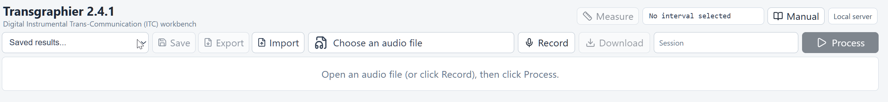{placement=H}

After that, the Waveform of the input file is shown:

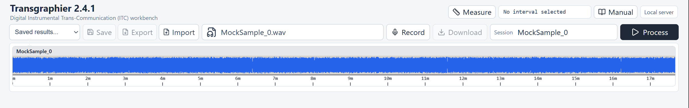{placement=H}

The next step is to press **Process**.

The app then processes the audio in an attempt to extract a *TapCode-encoded* text message (processing, downloading and displaying the result can take a while, depending on the length of the file).

The processing result is made of several parts:

 - The decoded message (on the top left box).

    If a message was decoded, it is displayed in a *bold, blue text*.
    
    If no message was decoded, is is indicated in a *red text*.
    
    The decoded text or the failure message is followed by a *Score*.
    
    The score followed by a *Branch Name*: processing may eventually branch out in order to try different parameters. The branch with the highest score is the result.

 - A sequence of intermediate text results (on the top right box)
   
 - A sequence of *signals* (right below the Waveform of the input)
 
   There are two types of result signals: **Audio Signals** and **Lexical Signals**.
   
   A Lexical Signal contains a sequence of **Symbols**, such that each symbol is located at a specific point in time, aligned with the corresponding point in time on the input sound. For example, sequences of *bits, bytes, letters and words* are all coming out as Lexical Signals.
   
   Both audio and lexical signals are displayed as Waveforms in the order in which the are produced.
   
   Depending on how far the processing went, some or all of the signals will be produced and displayed.
   
 - A full detailed text log (at the very bottom).

All of the displayed waveforms are _in sync_. You can place the cursor over _any_ of them and use the mouse wheel to Zoom In or Out _ALL_ of them at once (centered at the position of the cursor). You can also click and drag in order to pan the signals left or right. 


Below is a screen capture of an artificial _"successful"_ example:

\begin{figure}[H]
\centering
\includegraphics[width=\linewidth]{positive.png}
\caption{Message successfully decoded}
\end{figure}


And below an Unsuccessful one:

\begin{figure}[H]
\centering
\includegraphics[width=\linewidth]{failure.png}
\caption{No message decoded}
\end{figure}


# Processing Details

## Overview

The algorithm does, roughly, the following:

 - Preprocess, detect and isolate **Pulses** within the input audio. A Pulse is any isolated amplitud burst above the noise floor. The duration or shape of the pulse is not important, only its **Onset**: the time it ocurrs.
 
 - Compute *Pulse to Pulse* time gaps.
 
 - Find special runs of 5 or more pulses that are *Collectively Consecutive*. That is, their inter-pulse gap is roughly the same for all of them. These runs of pulses are called **Separators**.
 
 - Split the entire sequence of pulses into **Blocks** (based on the separators).
 
 - Within each Block:
 
   - Use the *Gap to Previous* time of each pulse to classify it as an **Intra-Count** pulse or not.
   
   - Group pulses into so-called **Tap Codes** (based on their Intra-Count classification).
   
   - Convert each *Tap Code* into a **Binary Symbol**: `0, 1, or ? (for bits that are uncertain)`.
   
   - Convert each binary sequence into a **Scored-byte Symbols** (taking uncertain bits into account).
   
   - Convert each scored-byte into a **Scored-ASCII Letter Symbols**.
   
 - Each partial result has a Score which is combined into the overall result score displayed in the top-left box. 

## Branching

There are certain steps along the processing pipeline at which alternative paths, with different parameters, might be taken. These are called **Branches**.

At the very end, there will be, _internally_ one or more results, each corresponding to a separate processing branch. 

Each branch gets an overall Score, and the winning branch is the one effectively selected as final result.

## Noise Gate

The first major step is a noise floor gate. This steps calculates the so-called **Noise Floor** and subtracts that from the entire signal.
The result is that only those *Amplitud Peaks* that are *above* the noise floor remain.

In a well-formed signal: one with the text nicely encoded as "correctly-timed, isolated energy bursts", each remaining peaks roughly maps to a single **"Tap"**

The gated signal is shown right below the input signal.

The calculated noise floor is shown, *after processing*, in the parameters section. You can inspect the Noise Get waveform result, calculate a better noise floor, and enter it manually in the noise floor parameter. After changing the parameter, you can click on Process again. It will re-do all the processing but using the new parameter.

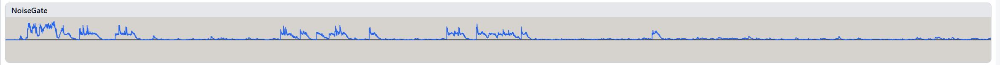{placement=H}

## Envelope And Upward Compression

The gated signal is then smoothed with a so-called **"Envelope Following"** step, and further enhanced with an **"Upward Compression"**.

These steps help equalize levels so that weaker but potentially meaningful bursts can be compared more fairly with stronger ones.

The results of the envelope and upward compression is shown in the waveform right below the noise gate.

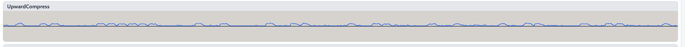{placement=H}

## Discretization

The signal is then converted into a square wave. This is shown in the **Discretized** waveform.

At this stage, every square matches a single Tap.

The upward-compressed signal from the previous step can be seen as being a sequence of *"Hills and Valleys"*. Discretization converts every "hill" into square of a fixed, flat height. What separates two distinct Hills is a Valley between them, but a valley is only such when its amplitude is significantly lower than that of the neighboring hills. The discretization, then, has to measure the amplitude variation across Hill->Valley->Hill, and decide whether that's two separate hills, or a single "merged" hill. This decision is controlled by the **"Discretize Merge Prominence"** parameter. You can change this if you notice that hills have been wrongly merged.

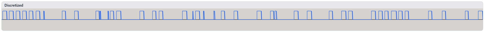{placement=H}

## Pulse Extraction

Each square-wave whose width (in Seconds) is larger than the **"Minimum Pulse Width"** is now converted into a **"Pulse"**.

The pulses are shown as square-waves in the Waveform right below Discretized.

Internally, however, the pulses are *NOT* an audio signal. They are a so-called **"Lexical Signal"** instead (which is just Rendered as square waves so you can see the pulses.

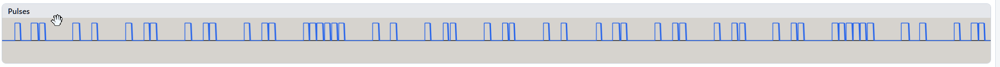{placement=H}

## Taps

Every Pulse is now converted into a **"Tap"**. From Tap to Tap there is a distance, in Seconds, thus every Tap has a *"Gap"* that corresponds to its distance to the previous Tap.

The app now makes an statistical analysis of the gaps, and finds the amount of time, in seconds, known as the **"Intra Count Gap"**. Every Tap that is separated from its previous Tap no more than this distance (in seconds) is *classified* as a **"Intra-Count Tap"**.

All Taps are shown in a Waveform in which each Tap is shown as a square wave of a given color, either above or below the center line.
Every Tap whose gap is larger than the intra-count threshold is shown in **Yellow**. Every Tap that is an "intra-count" tap is shown in **Green**.

Every Yellow Tap *starts a new* formal count of 1. If it is followed by one or more Green Taps, the total count of the "Run" is the number of Green taps plus 1.

For example, consider the following sequence of Taps:

They correspond to the following sequence of Counts:

```1, 1, 1, 2, 1, 1, 2, 1, 1, 1, 2, 1, 1, 1, 7```

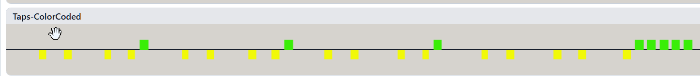{placement=H}

## Tap-Codes

The classified Taps from the previous filter, that is, the sequence of formal **"Counts"** are grouped as Tap-Codes and Separators:

Every count of 5 or more is a **Separator**
Within separators, counts are paired into the so-called **"Tap Code"**. Each Tap Code has a Row Count and a Column Count.

Tap Codes and Separators are shown, color-coded, in the next Waveform. Row counts are Red, Column counts are Blue, and Separators are black:

For example, the Waveform below shows the following groups of tap codes (the separator is represented by (0,0))

```
(1,1),(1,2),(1,1),(1,2),(1,1),(1,2),(1,1),(1,1),(0,0)
(1,1),(1,2),(1,2),(1,1),(1,2),(1,1),(1,1),(1,1),(0,0)
```

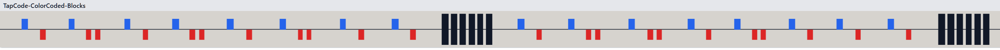{placement=H}

## Text Decoding and Scoring

Each tap code is a pair of counts that corresponds to the *Row* and *Column* indices into a special matrix known as a **"Polybius Square"**. The square has *Symbols* into each possible cell.

Here is a simple binary Polybius Square:

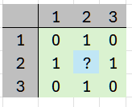{placement=H}

As you can see, using the simple binary square, the tap-code `(1,1)` corresponds to the very first Cell, at the top-left, and it contains the symbol **0**. Likewise, `(1,2)` maps to `**1**`, while `(2,2)` maps to `**?**`.

Therefore, each extracted tap code, if any, is converted into a **Uncertain Binary Digit**: `0, 1 or ?`

Each tap-code *group* corresponds to a so-called **"Fuzzy Byte"** such as `**010?01??**`. This a byte in which certain bits are unknown.  Every fuzzy byte is converted into a **"Scored Resolved Byte"**. That is well-formed byte, in which every '?' is resolved as a '0', *but*, the bye is given a *Score* based on the ratio of certain vs uncertain bits.  For example, the fuzzy-byte: `**00000000**` maps to a value of 0 with a score of 1 (100%), but `**????????**` maps to a value which is also 0 but with a score of 0.

Each resolved byte is then mapped into an ASCII letter, if any, or into the letter "!". Separator letters (such as a Space) are found, and the entire letters stream split into words. Each word is looked up into an English dictionary and given a score.

Each individual score along the process is combined into a unified overall score.

## Blocks

Depending on the successful extraction of separators, the entire audio is split up into Blocks. Within each block, the tap-codes are converted into Uncertain Binary Digits and these grouped into a Fuzzy Byte, which is then mapped into a Resolved Byte.

Since it is the separators which mark the block boundaries, it can very well happen that a given block has less or more than 8 Uncertain Bits.
If it has less than 8, it is just paired. If it has more, the ones with the highest score, in their order, are kept, and any additional excess is trimmed.

For example, the fuzzy-byte: `**0101**` maps into the actual byte `**01010000**`. The fuzzy-byte: `**0?1?0?0?1?1????01**` maps to `**01001101**` because the certain bits win over the uncertain ones in this case of excess. Likewise, the fuzzy-byte `**10100101111111**` becomes just `**10100101**` (the trailing ones are just trimmed).

If separators where found, so it was possible to extract blocks, the *Block Navigation Buttons*, at the very top, will be enabled. You can then *Zoom* into *One* block at a time, and move forward or backwards across all detected blocks:

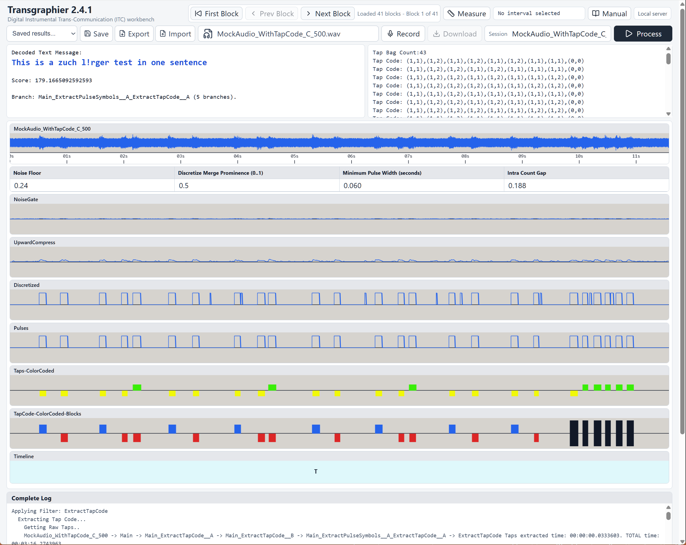{placement=H}


## Text Timeline

If the processing was able to extract bytes, then each block corresponds to a byte, and each byte to an ASCIII **Letter** (or a **!** if the byte does not match any ASCII). 

The letters are shown in the **Timeline** view, at bottom. Each letter is aligned with its block.

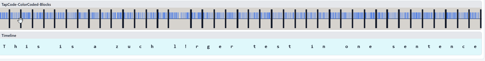{placement=H}


